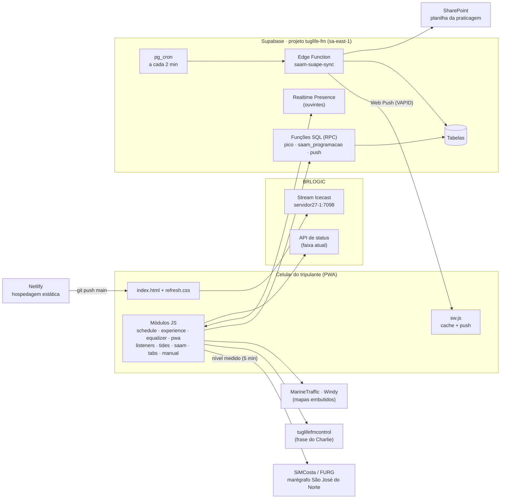
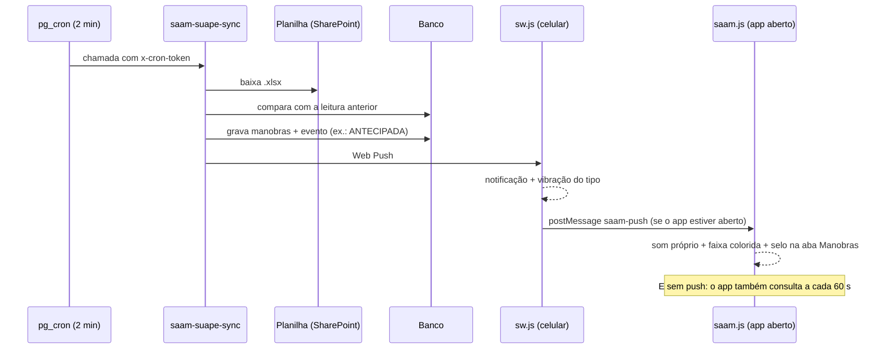

# TugLife FM — Documentação do Projeto

| | |
|---|---|
| **Projeto** | TugLife FM · App da rádio (PWA) |
| **Versão do app** | 3.8.0 (SPRINT 26) |
| **Documento** | 1.5.0 · 2026-10-15T00:30:00-03:00 |
| **Autor** | Jossian Brito (Charlie Bravo) |
| **Site** | https://radiotuglifefm.netlify.app |
| **Repositório** | https://github.com/Jbvix/radiotuglifefm |
| **Licença** | CC BY-NC 4.0 (código próprio) · terceiros: ver §12 |

> **Histórico deste documento**
> - 1.5.0 (2026-10-15) — Aviso de nova versão (SPRINT 26): `SKIP_WAITING` no `sw.js`, faixa no `pwa.js`, §8 com o novo fluxo de atualização, teste `update-check.cjs`.
> - 1.4.0 (2026-10-15) — Aba Rádio compacta (SPRINT 25): faixa atual no player, painel "Mais da TugLife", rodapé só no computador; teste `radio-check.cjs`.
> - 1.3.0 (2026-10-15) — Nível medido em mais 4 portos (Pecém, Rio de Janeiro, Paranaguá, Salvador), segunda API (IOC/UNESCO), decisão de deixar Itaqui de fora, ferramenta de offset 1.2.0 e cenários 10–11 no teste.
> - 1.2.0 (2026-10-14) — Nível medido em Suape (média Recife + Tamandaré, correção de horário de porto secundário), §6.4 reescrito, maré meteorológica pela mediana dos resíduos, ferramenta de offset 1.1.0 e 3 cenários novos no teste.
> - 1.1.0 (2026-10-12) — Nível medido ao vivo (SiMCosta/FURG): `tide-live.js`, fluxo §6.4, calibração do zero do radar, teste e ferramenta novos.
> - 1.0.0 (2026-10-12) — Primeira edição: diretórios, módulos, backend, fluxos, deploy, testes e convenções, cobrindo até a v3.3.0.

**Como ler.** O §2 é a carta náutica (onde está cada arquivo). Os §3–§7 são o plano de máquinas (como as peças se ligam). Os §8–§11 são a rotina de bordo (versão, deploy, testes, convenções). O manual de uso do tripulante fica no `README.md` (seção "Manual de bordo"), gerado a partir de `manual.js`.

---

## 1. Visão geral

A TugLife FM é uma webrádio 24/7 (stream BRLOGIC). O app começou como um player e virou um **canivete suíço do marítimo**, com 5 funções em uma tela:

| Função | O que entrega | Desde |
|---|---|---|
| **Rádio** | Player ao vivo, espectro, programa no ar, próximo programa, grade semanal, faixa atual | v1 → v2.2 |
| **Tripulação a bordo** | Ouvintes conectados agora e pico do dia | v2.6.0 |
| **Tábua de Maré** | 13 portos, previsão harmônica calibrada com a Tábua DHN 2026 | v2.7.0 → v2.9.2 |
| **Programação SAAM · Suape** | Manobras SAAM com PIN, 3 alertas sonoros e notificação push | v3.0.0 |
| **Painel do Marujo** | Mapa AIS (MarineTraffic) e clima (Windy) por porto | v2.x |

E ainda: layout em abas no celular (v3.1.0), Manual de bordo e tour guiado (v3.2.0), grade recolhível (v3.3.0), nível do mar **medido** ao vivo em Rio Grande (v3.4.0), Suape (v3.5.0), Pecém, Rio de Janeiro, Paranaguá e Salvador (v3.6.0).

### Princípios de projeto

1. **Site estático, sem etapa de build.** HTML, CSS e JavaScript puros, publicados como estão. Qualquer arquivo pode ser aberto e lido diretamente — como um quadro elétrico com todos os cabos etiquetados, sem caixa-preta.
2. **Módulos independentes, como sensores externos.** Cada recurso (ouvintes, maré, SAAM, abas, manual) é um arquivo próprio que apenas *observa* o player e o DOM, sem reescrevê-los. Se um módulo falha, os outros continuam — falha isolada, como um circuito com disjuntor próprio.
3. **Degradação graciosa.** Sem internet: grade, maré e manual continuam (service worker). Sem Supabase: some o contador de ouvintes, a rádio segue. Sem Web Audio/CORS: some o espectro, o áudio segue.
4. **Mobile first.** Projetado para o celular do tripulante no convés (sol forte → tema claro; toque ≥ 44 px; uma tela por função).
5. **Segurança no servidor.** Nada sensível no app: a programação SAAM só sai do banco mediante PIN validado por função SQL, com hash bcrypt e trava contra tentativa e erro.

---

## 2. Estrutura de diretórios

```
radiotuglifefm/
├── index.html              Página única do app: estrutura, estilos-base e o "motor" do player
├── refresh.css             Camada visual atual (grade/desktop, celular, abas, maré, SAAM, manual)
├── manifest.webmanifest    Identidade do PWA (nome, ícones, cores, modo standalone)
├── sw.js                   Service worker: cache do app (offline), push SAAM e troca de versão sob comando (SKIP_WAITING)
│
├── schedule.js             Grade semanal (dados) e cálculo "no ar agora / próximo"
├── schedule-ui.js          Interface da grade: dias, "Hoje", lista, relógio, painel recolhível
├── experience.js           Mini-player, duração e barra de progresso do programa
├── equalizer.js            Motor Web Audio (analisador) + espectro circular de barras
├── pwa.js                  Instalar app, compartilhar, QR Code, aviso de offline, painel "Mais da TugLife", aviso de nova versão
├── listeners.js            "Tripulação a bordo": ouvintes ao vivo e pico do dia (Supabase)
├── tide-data.js            Constantes harmônicas calibradas dos 13 portos
├── tides.js                Card "Tábua de Maré": cálculo, curva 24 h, extremos, navegação
├── tide-live.js            Nível MEDIDO ao vivo em 6 portos (SiMCosta e IOC/UNESCO; Suape = média de 2) e maré meteorológica
├── saam.js                 Card "Programação SAAM · Suape": PIN, lista, alertas, push
├── tabs.js                 Navegação por abas no celular + selo de alerta em Manobras
├── manual.js               Manual de bordo + tour guiado (fonte única dos textos)
│
├── vendor/
│   └── tide-engine.js      @neaps/tide-predictor 0.11.0 empacotado (terceiro, MIT) — não editar
│
├── assets/
│   ├── brand.png           Capa/logo circular (também imagem de compartilhamento)
│   ├── icon-192.png        Ícone do app (192 px)
│   ├── icon-512.png        Ícone do app (512 px)
│   ├── apple-touch-icon.png Ícone para iPhone/iPad
│   └── share-qr.png        QR Code para https://radiotuglifefm.netlify.app/
│
├── tools/                  Ferramentas de bastidor (não são carregadas pelo app)
│   ├── manual/
│   │   └── gerar-readme.mjs  Gera a seção "Manual de bordo" do README a partir de manual.js
│   ├── mare/               Calibração das marés contra a Tábua DHN
│   │   ├── README.md         Passo a passo da calibração anual
│   │   ├── calib.mjs         Ajusta e valida cada porto (4 métodos × estações candidatas)
│   │   ├── assemble.mjs      Escolhe a melhor combinação por porto → tides-data-v2.json
│   │   ├── runall.sh         Roda a calibração de todos os portos
│   │   └── simcosta-offset.mjs Recalcula o zero do marégrafo SiMCosta → NR (usa a API)
│   └── saam/               Coletor da programação SAAM (backend)
│       ├── README.md         Papel de cada arquivo, agendamento, troca de PIN
│       ├── index.ts          Edge Function "saam-suape-sync" (Supabase, Deno)
│       ├── parser.js         Leitor de .xlsx leve (abas visíveis, colunas pelo cabeçalho)
│       ├── regras.js         Casamento entre leituras e geração dos 3 alertas
│       └── test.mjs          Testes com planilha sintética
│
├── docs/
│   ├── PROJETO.md          Este documento
│   └── superpowers/        Especificação e plano das melhorias de UX (abr/2026)
│
├── browser-check.cjs       Teste de navegador: larguras, grade, tema, mapa, mini-player
├── pwa-check.cjs           Teste de navegador: manifesto, QR, instalação, offline
├── equalizer-check.cjs     Teste de navegador: espectro, pausa, movimento reduzido, CORS
├── manual-check.cjs        Teste de navegador: manual, tour, #manual, desktop
├── radio-check.cjs         Teste de navegador: aba Rádio numa tela (390×844), painel "Mais", desktop
├── update-check.cjs        Teste de navegador: aviso de nova versão com deploys simulados (servidor próprio)
├── tide-live-check.cjs     Teste de navegador: nível medido (APIs simuladas) em 11 cenários
├── schedule.test.cjs       Teste unitário da grade (node:test)
├── server.py               Servidor local (porta 8787) para desenvolvimento e testes
│
├── VERSION.json            Versão e data/hora da versão publicada
├── REPORT.md               Diário de sprints (o que mudou, como foi verificado, bugs)
├── README.md               Apresentação + Manual de bordo (gerado) + como rodar
├── LICENSE                 CC BY-NC 4.0
└── .gitignore              Mantém fora arquivos do projeto de impressão 3D
```

---

## 3. Arquitetura



**Leitura do diagrama.** O app é só "casco": arquivos estáticos servidos pelo Netlify. Tudo o que é dinâmico vem de serviços externos. O único serviço com regra de negócio própria é o Supabase: um "marinheiro de vigia" (pg_cron) acorda a cada 2 minutos, lê a planilha da praticagem, compara com a leitura anterior e, se algo mudou, grava o evento e dispara o push.

### Ordem de carregamento (`index.html`, todos com `defer`)

| # | Script | Por que nessa posição |
|---|---|---|
| 1 | `schedule.js` | Define `window.RadioSchedule`, usado por 2, 3 e pelo motor |
| 2 | `schedule-ui.js` | Desenha a grade e o relógio |
| 3 | `experience.js` | Mini-player e progresso (precisa do `#program-current`) |
| 4 | `equalizer.js` | Define `window.RadioAudio`, usado pelo motor do player |
| 5 | `pwa.js` | Instalar/compartilhar e registro do service worker |
| 6 | `supabase-js@2` (CDN) | Cliente Realtime para o módulo de ouvintes |
| 7 | `listeners.js` | Ouvintes (precisa de 6) |
| 8–11 | `vendor/tide-engine.js` → `tide-data.js` → `tides.js` → `tide-live.js` | Motor → constantes → card → nível medido (usa `window.TugTides`) |
| 12 | `saam.js` | Card SAAM; emite o evento `saam:alerta` |
| 13 | `tabs.js` | Abas; ouve `saam:alerta`; expõe `window.TugTabs` |
| 14 | `manual.js` | Manual e tour; usa `window.TugTabs` |
| — | script inline no fim do `index.html` | Tema, player (play/pausa, estado), faixa atual, frase do Charlie, mapa |

---

## 4. Módulos do app

| Arquivo | Responsabilidade | Elementos/IDs principais | Fala com | Versão |
|---|---|---|---|---|
| `index.html` (inline) | Tema claro/escuro; play/pausa do `<audio>`; faixa atual (20 s); frase do Charlie (15 s); portos e mapa | `#btn-play`, `#radio-stream`, `#now-playing-brlogic`, `#card-charlie`, `#mariner-panel`, `#map-view` | BRLOGIC status, tuglifefmcontrol, MarineTraffic, Windy | 3.3.0 |
| `schedule.js` | Grade da semana (texto `HH:MM\|Programa` por dia) e `getState()` → programa atual/próximo no fuso de Brasília | — (só dados) | — | 2.1.0 |
| `schedule-ui.js` | Botões dos dias, "Hoje", lista com "No ar agora", relógio digital; painel recolhível | `#schedule-panel`, `#schedule-days`, `#schedule-list`, `#digital-clock` | `RadioSchedule` | 3.3.0 |
| `experience.js` | Mini-player (faixa ao vivo) e duração/progresso do programa | `#mini-play`, `#mini-status`, `.program-duration` | `RadioSchedule` | 2.2.0 |
| `equalizer.js` | Prepara o Web Audio (confere CORS antes); espectro circular; respeita "movimento reduzido" | `#spectrum-bars`, `#spectrum-status` | stream BRLOGIC | SPRINT 08 |
| `pwa.js` | Instalar app, diálogo de compartilhamento/QR, copiar link, aviso offline, registro do SW; abre o painel "Mais da TugLife" no computador e rola até ele no celular | `#install-app`, `#share-radio`, `#share-dialog`, `#network-status`, `#more-panel` | — | 3.7.0 |
| `listeners.js` | Presença em tempo real ("N a bordo") e pico do dia; só observa os eventos do `<audio>` | `#crew-row`, `#crew-count`, `#crew-peak` | Supabase Realtime + RPC `registrar_pico`, `pico_hoje` | 2.6.0 |
| `tide-data.js` | Constantes harmônicas por porto, método de calibração e erro típico | — (só dados) | — | 2.9.0 |
| `tides.js` | Altura agora, tendência, extremos do dia, curva SVG 24 h, navegação por dia, porto lembrado | `#card-mare`, `#tide-port`, `#tide-chart`, `#tide-list` | `NeapsTide`, `TUGLIFE_TIDES` | 3.4.0 |
| `tide-live.js` | Nível medido agora (previsão + mediana dos resíduos de 10 min), tendência (reta de 30 min), maré meteorológica, série de 6 h no gráfico, busca incremental a cada 5 min, várias fontes por porto (média, uma pode cair), correção de horário de porto secundário, duas APIs (SiMCosta e IOC), volta à previsão se o dado tiver > 30 min | `#tide-live`, `.tide-real` | APIs SiMCosta e IOC; `window.TugTides` | 3.6.0 |
| `saam.js` | PIN, lista por dia, sincronização a cada 60 s, 3 sons sintetizados + vibração, faixa de alerta, push | `#card-saam`, `#saam-pin`, `#saam-list`, `#saam-events`, `#saam-banner` | RPC `saam_programacao`, `saam_push_registrar`; SW | 3.1.0 |
| `tabs.js` | Barra de abas (≤ 760 px), aba lembrada, selo de alertas, `#card-saam` abre Manobras | `#tabbar`, `#tab-badge`, `body[data-aba]` | evento `saam:alerta` | 3.2.0 |
| `manual.js` | Botão ?, Manual de bordo (seções, sanfona, "Abrir a aba"), tour de 6 passos, `#manual` | `#help-btn`, `#manual-dialog`, `.tour-camada` | `TugTabs` | 3.6.0 |
| `sw.js` | Cache versionado só do app (nunca do stream nem de APIs); push SAAM com vibração por tipo; clique abre `#card-saam`; versão nova fica em espera até a mensagem `SKIP_WAITING` | — | Web Push | 3.8.0 |

### Contratos entre módulos

| Contrato | Quem publica | Quem usa | Para quê |
|---|---|---|---|
| `window.RadioSchedule` | `schedule.js` | grade, mini-player, motor | Programa atual/próximo |
| `window.RadioAudio.prepare(audio)` | `equalizer.js` | motor do player | Um único `AudioContext` compartilhado |
| `body[data-aba]` | `tabs.js` | `refresh.css`, `manual.js` | Qual aba está à vista |
| `window.TugTabs.abrir(aba)` | `tabs.js` | `manual.js` | Trocar de aba pelo manual/tour |
| evento `saam:alerta` | `saam.js` | `tabs.js` | Acender o selo de Manobras |
| mensagem SW `saam-push` | `sw.js` | `saam.js` | Tocar o som próprio com o app aberto |
| `window.TugTides` (`render`, `porto`, `preditor`, `hoje`) | `tides.js` | `tide-live.js` | Redesenhar e comparar medido × previsto |
| `window.TugTideLive` (`ativo`, `serie`, `aoDesenhar`) | `tide-live.js` | `tides.js` | Caixa "Ao vivo", linha verde, rótulo "Previsto agora" |
| `data-tab="…"` em cada bloco | `index.html` | `refresh.css` | Qual bloco pertence a qual aba |

### Dados guardados no aparelho (`localStorage`)

| Chave | Conteúdo |
|---|---|
| `tuglife_aba` | Última aba aberta |
| `tuglife_tour_visto` | Versão do tour já vista (`manual.js` → `tourVersao`) |
| `tuglife_saam_pin` | PIN da tripulação (apagado por "Bloquear neste aparelho") |
| `tuglife_saam_ultimo` | Último evento SAAM já tocado (evita repetir som) |
| `tuglife_saam_alertas` | Alertas ligados/desligados |
| `tuglife_tide_port` | Último porto escolhido na maré |
| `tuglife_client_id` (sessionStorage) | Identificador anônimo da sessão para a contagem de ouvintes |

Todo acesso é protegido por `try/catch`: em modo anônimo o app funciona, só não lembra.

---

## 5. Backend (Supabase · projeto `tuglife-fm`, região sa-east-1)

### Tabelas

| Tabela | Conteúdo | Acesso público |
|---|---|---|
| `audiencia_horaria` | Pico de ouvintes por hora | Só via RPC |
| `saam_manobras` | Manobras lidas da planilha (Suape), com contador de ausências | Nenhum |
| `saam_eventos` | Alertas gerados (CONFIRMADA, CANCELADA, ANTECIPADA) | Nenhum |
| `saam_push` | Inscrições Web Push dos aparelhos | Nenhum |
| `saam_config` | `pin_hash` (bcrypt), chaves VAPID, link da planilha, token do cron | Nenhum |
| `saam_sync` | Situação da última leitura (para o "lida há N min") | Nenhum |
| `saam_pin_falhas` | Tentativas de PIN errado (trava > 20 em 10 min) | Nenhum |

### Funções chamadas pelo app (`/rest/v1/rpc/<função>`)

| Função | Faz |
|---|---|
| `registrar_pico(...)` / `pico_hoje()` | Grava e lê o pico de ouvintes |
| `saam_programacao(p_pin)` | Valida o PIN e devolve manobras SAAM (exceto removidas), eventos, situação da leitura e a chave VAPID pública. PIN errado → `{erro}` (sem exceção, para a tentativa ficar registrada) |
| `saam_push_registrar(...)` / `saam_push_desligar(endpoint)` | Liga/desliga a notificação no aparelho |

### Coletor `saam-suape-sync` (Edge Function, código em `tools/saam/`)

1. `pg_cron` chama a função a cada 2 min, com o cabeçalho `x-cron-token`.
2. Baixa a planilha pelo link público do SharePoint, seguindo os redirecionamentos com o cookie de sessão.
3. Lê só as abas visíveis e filtra Suape. A data vem como número serial do Excel, convertido assim:
   `instante_UTC = (serial − 25569) × 86 400 000 ms + 3 h`
   — 25569 é o número de dias entre 1900 e 1970 (época do Unix); as 3 h levam o horário de Brasília para UTC. Ex.: serial 46307,75 → 12/10/2026 18:00 (Brasília).
4. Casa cada manobra com a leitura anterior por IMO + tipo + horário de embarque do prático mais próximo (até 48 h), comparando só os últimos 3 dias.
5. Gera os alertas:

| Alerta | Quando |
|---|---|
| CONFIRMADA | Situação passa a "confirmada" |
| CANCELADA | Situação "cancelada", troca de empresa, ou sumiço da planilha em 2 leituras seguidas |
| ANTECIPADA | Horário adiantado em 15 min ou mais |
| (nenhum) | Adiamento; e a 1ª leitura, que é só a linha de base |

6. Grava e envia o push para os aparelhos inscritos.

**Dependência conhecida:** se o link público da planilha mudar, atualize `saam_config.planilha_url`. Troca de PIN: SQL em `tools/saam/README.md`.

---

## 6. Fluxos principais

### 6.1 Alerta SAAM, da planilha ao bolso do Comandante



Tela apagada → o som é o padrão do celular (o navegador não permite som próprio por tipo); no iPhone o push só funciona com o app instalado na tela de início.

### 6.2 Maré

`tides.js` monta, para o porto escolhido, a soma de ondas senoidais (previsão harmônica):

`h(t) = Z0 + Σ fᵢ · Aᵢ · cos(ωᵢ·t + (V₀+u)ᵢ − gᵢ)`

- **Z0**: nível médio sobre o Nível de Redução da DHN. Muda a régua: sobe ou desce a curva inteira.
- **Aᵢ, gᵢ**: amplitude e fase de cada componente (M2, S2, K1, O1…), em `tide-data.js`. A amplitude define o tamanho da onda; a fase, quando ela chega.
- **ωᵢ**: velocidade angular (M2 ≈ 28,98°/h → período de 12 h 25 min).
- **fᵢ, uᵢ**: correções nodais do ciclo lunar de 18,6 anos, calculadas pelo motor.

Exemplo: em Suape a M2 domina (amplitude ~0,7 m); quando M2 e S2 estão em fase (sizígia), as amplitudes se somam e dá maré de águas vivas; em quadratura elas se subtraem e dá águas mortas — a mesma superposição de duas ondulações que se reforçam ou se anulam no costado.

A calibração (`tools/mare/`) ajusta esses números para casar com a Tábua DHN 2026; o erro típico aparece no selo verde do card.

### 6.3 Ouvintes

Cada app tocando entra num canal de presença do Supabase e o contador mostra quantos estão ali. Os apps enviam a contagem para `registrar_pico`, e o banco guarda por hora `pico_da_hora = MAX(pico_atual, enviado)` (teto de 1000, contra valores absurdos) — o maior valor da hora nunca diminui, como o ponteiro de arraste de um manômetro. `pico_hoje` devolve o maior pico do dia.


### 6.4 Nível medido ao vivo (SiMCosta/FURG e IOC/UNESCO · 6 portos)

O card de Maré mostra, além da previsão, o nível **real** medido por marégrafos radar do SiMCosta. Cada porto tem uma lista de **fontes** em `ESTACOES` (`tide-live.js`), cada uma com o seu offset.

| Porto | Fonte(s) | Offset (zero do radar → NR) | Correção de horário | Incerteza | Calibração |
|---|---|---|---|---|---|
| Rio Grande | São José do Norte (id 332) | 12,374 m | 0 | ±7 cm | 12/09–12/10/2026 |
| Suape | Recife (id 330, UFPE) + Tamandaré (id 399, CEPENE/UFPE) | 10,311 m e 10,305 m | +11 min | ±4 cm | 15/09–15/10/2026 |
| Pecém | Pecém (id 307) | 9,293 m | 0 | ±3 cm | 15/09–15/10/2026 |
| Rio de Janeiro | Niterói/DHN (id 304), ~2 km da Ilha Fiscal | 11,528 m | 0 | ±7 cm | 15/09–15/10/2026 |
| Paranaguá | Paranaguá (id 300, CEM/UFPR) | 11,295 m | 0 | ±9 cm | 15/09–15/10/2026 |
| Salvador | IBGE/RMPG via IOC (código `salv`, sensor `rad`) | 4,195 m | 0 | ±3 cm | 15/09–15/10/2026 |

- **Fontes:** (1) API pública e documentada do SiMCosta (https://simcosta.furg.br/q/docs/) — `GET /api/intrans_data?boiaID=<id>&type=json&time1=&time2=&params=avg_water_level_arbitrary_zero`. 1 leitura/min, CORS liberado, sem login. Lista de estações em `GET /q/stations`. 1ª carga ~50 KB por fonte (6 h); depois só o que chegou (~1 KB a cada 5 min). (2) IOC Sea Level Monitoring/UNESCO — `GET https://www.ioc-sealevelmonitoring.org/service.php?query=data&code=salv&timestart=<ISO UTC>&timestop=<ISO UTC>&format=json`, com vários sensores misturados na resposta (o app usa só `fonte.sensor`). Cada fonte declara `api` e a `faixa` de leituras válidas. As fontes de um porto são buscadas em paralelo.
- **Do zero do radar ao NR:** `nível_NR = leitura − OFFSET`. O offset é a média de (leitura − previsão) em ~720 horas; a oscilação semanal vira a incerteza exibida. Recalcular com `node tools/mare/simcosta-offset.mjs <porto> 30` quando os radares forem amarrados à rede do IBGE ou reinstalados.
- **Várias fontes (Suape):** minuto a minuto, média das fontes no ar: `nível_NR(t) = (1/n) · Σ [leitura_i(t) − OFFSET_i]`. A série vai só até o último minuto que todas as fontes ativas já mandaram (sem degrau no fim). Fonte com dado > 30 min sai da média e a faixa avisa ("Só Tamandaré no ar (Recife sem dado)"). Em 30 dias, Recife e Tamandaré no NR diferiram 0,0 cm em média (RMS 3,2 cm).
- **Porto secundário (Suape):** em Recife e Tamandaré a maré chega ~11 min antes da previsão de Suape (melhor ajuste em 30 dias, passos de 1 min, igual nas duas). A leitura é transferida para Suape com `t_porto = t_leitura + 11 min`, como nas correções de porto secundário da DHN. Sem isso, perto da meia-maré (~0,5 m/h) surgiria uma maré meteorológica falsa de ~9 cm. A idade do dado continua no relógio real.
- **Maré meteorológica:** `surge = mediana_10min( nível_NR(tᵢ) − previsão(tᵢ) )` e `nível agora = previsão(último minuto) + surge`. Destaque laranja a partir de ±15 cm. Rio Grande: em 30 dias, de −34 a +108 cm (RMS 13 cm), mais que a maré astronômica local. Suape: de −12 a +10 cm (RMS 4,1 cm).
- **Incerteza exibida:** metade da oscilação semanal do offset, no mínimo 3 cm (a ferramenta imprime a sugerida).
- **Itaqui fica de fora:** o marégrafo mais próximo (Ribamar, id 302) está em outra baía, com amplitude 18% menor; mesmo com correção de amplitude e horário sobram ~21 cm de erro de transferência, que apareceriam como maré meteorológica falsa. Sem fonte para Santos, Itajaí, Vitória, Vila do Conde, Amapá e Sepetiba: estações mudas (Aracruz, Belém, Santana) ou distantes demais (Ilhabela, Imbituba).
- **Validação:** Pecém, Salvador e Suape: correlação ≥ 0,99, diferença típica ≤ 5 cm (a previsão acerta). Rio de Janeiro: 0,93 e 12 cm. Paranaguá: 0,86 e 28 cm (de −78 a +91 cm: o vento manda, como em Rio Grande). Rio Grande — correlação medido × previsto de só 0,39 (a previsão explica pouco). Suape — correlação 0,996 (Recife) e 0,992 (Tamandaré), amplitude medida/prevista 1,03 e 1,00: a previsão calibrada pela DHN acerta; o medido serve para confirmar e flagrar o fora do normal.
- **Segurança da informação:** dado com mais de 30 min ou falha da API → a caixa avisa e o app volta só à previsão. Crédito obrigatório por porto (`credito` em `ESTACOES`): SiMCosta/FURG; Suape + UFPE e CEPENE; Paranaguá + CEM/UFPR; Salvador "IBGE (RMPG), via IOC/UNESCO".

---

## 7. Interface

- **Celular (≤ 760 px):** tela única com cabeçalho fixo e barra de abas **Rádio | Maré | Manobras | Portos**. Cada bloco declara sua aba em `data-tab` e o CSS mostra só a aba ativa (`body[data-aba]`). Fora da aba Rádio, a faixa ao vivo fica acima da barra. Aba Rádio numa tela só (v3.7.0): player com a faixa atual (♪), relógio numa linha, grade semanal e "Mais da TugLife" recolhidos; rodapé oculto.
- **Computador:** grade de duas colunas com todos os cards visíveis; barra de abas oculta; grade semanal aberta; "Mais da TugLife" aberto numa linha logo abaixo do cabeçalho.
- **Tema:** escuro por padrão, claro pelo botão da lua.
- **Acessibilidade:** botões reais, `aria-label` em ícones, alvos ≥ 44 px, respeito a "movimento reduzido", contraste do tema claro reforçado.

---

## 8. Versões, atualização e deploy

### Onde a versão aparece (atualizar todos a cada versão)

| Lugar | O que mudar |
|---|---|
| `VERSION.json` | `version` e `date` |
| `index.html` | `<title>`, comentário de cabeçalho (versão, data, modificações), rodapé (versão e "Atualização"), "TugLife FM Engine" |
| `sw.js` | `CACHE = 'tuglife-shell-vX.Y.Z'` e, se houver arquivo novo, a lista `FILES` |
| Arquivo(s) alterado(s) | Cabeçalho com versão, data/hora e histórico |
| `REPORT.md` | Nova seção de SPRINT no topo |
| `manual.js` | `versao` e `novidades`; `tourVersao` só se o tour precisar ser revisto |
| `README.md` | `node tools/manual/gerar-readme.mjs` |

### Deploy

1. `git push` na branch `main`.
2. O Netlify publica sozinho em 3–5 min (site `radiotuglifefm`).
3. Confira `https://radiotuglifefm.netlify.app/VERSION.json`.

### Atualização no celular

O service worker guarda a versão anterior inteira (HTML, scripts e imagens da mesma versão juntos). Trocar o nome do cache força a renovação.

**Desde a v3.8.0 (aviso de nova versão):**
1. O navegador acha o `sw.js` novo, ao abrir o app ou ao voltar para ele (`pwa.js` chama `registration.update()` no máximo a cada 30 min), e instala a versão nova, que **fica em espera**. Ela nunca troca sozinha.
2. O `pwa.js` mostra a faixa **"Nova versão X.Y.Z disponível · Atualizar"**, com o número lido do `VERSION.json`. Com a rádio tocando, a faixa avisa que o áudio para por alguns segundos.
3. O toque envia `SKIP_WAITING` ao SW em espera; ele assume (`controllerchange`) e a página recarrega já na versão nova. Outras abas recarregam sozinhas, a menos que estejam tocando; nesse caso só avisam.
4. "×" dispensa a faixa até a próxima abertura. Na 1ª visita não há aviso nem recarga.

Quem estava numa versão anterior à 3.8.0 precisa ainda **fechar e reabrir o app duas vezes** uma última vez para chegar nela; dali em diante, basta o toque.

---

## 9. Desenvolvimento e testes

### Rodar localmente

```bash
python3 server.py          # http://localhost:8787/
```

### Testes

| Teste | Comando | Cobre |
|---|---|---|
| Grade (unitário) | `node schedule.test.cjs` | Programa atual/próximo, virada de dia |
| Navegador · geral | `node browser-check.cjs` | 4 larguras sem estouro, grade, tema, mapa sob demanda, mini-player, erro de conexão |
| Navegador · PWA | `node pwa-check.cjs` | Manifesto, ícones, QR, copiar link, instalação, offline |
| Navegador · nova versão | `node update-check.cjs` | Servidor próprio (porta 8799) simula deploys: 1ª visita sem aviso nem recarga, faixa "Nova versão 9.9.2 disponível", "×" dispensa, rádio tocando não troca sozinha e avisa, "Atualizar" recarrega na versão nova |
| Navegador · aba Rádio | `node radio-check.cjs` | 390×844 sem rolagem; com ouvintes conectados (390×844 e 412×823) a linha 👥 não encavala o selo e o "Mais" segue à vista; com play, faixa, grade e "Mais" à vista; painel fechado no celular e aberto numa linha no computador; manual → "Instalar na tela inicial"; rodapé só no computador |
| Navegador · espectro | `node equalizer-check.cjs` | Pausa/retomada, movimento reduzido, falha de CORS mantém o áudio |
| Navegador · manual | `node manual-check.cjs` | Tour automático, manual por seção, "Abrir a aba", `#manual`, desktop |
| Navegador · nível medido | `node tide-live-check.cjs` | API SiMCosta simulada: Rio Grande ao vivo (+12 cm), busca incremental, outro dia, outro porto, dado velho, falha; Suape com 2 fontes (média e horário corrigido), 1 fonte fora e as 2 fora; Pecém, Rio, Paranaguá e Salvador (IOC com sensor de isca); Itaqui sem busca |
| README em dia | `node tools/manual/gerar-readme.mjs --check` | Manual do README igual ao `manual.js` |
| Coletor SAAM | `cd tools/saam && npm i xlsx fflate && node test.mjs` | Leitor da planilha e regras de alerta (planilha sintética) |

Os testes de navegador usam Playwright com o Edge do Windows (`channel: 'msedge'`). O `manual-check.cjs` aceita outro Chromium via `PW_CHROME=/caminho/chrome`. Com o servidor local rodando em outro terminal.

---

## 10. Ferramentas de bastidor (`tools/`)

| Pasta | Quando usar |
|---|---|
| `tools/manual/` | Sempre que mudar `manual.js` — regenera o README |
| `tools/mare/` | Uma vez por ano, com a nova Tábua DHN (os PDFs da DHN não ficam no repositório); `simcosta-offset.mjs` quando o marégrafo SiMCosta mudar de referência |
| `tools/saam/` | Ao alterar o coletor; o código publicado fica na Edge Function do Supabase |

---

## 11. Convenções da casa

- **Cabeçalho em todo arquivo próprio:** projeto, arquivo, versão (SPRINT), data/hora com fuso, autor e histórico de modificações (`[NOVO]`, `[MOD]`, `[REM]`).
- **Comentários explicam o porquê** e o comportamento de fórmulas (o que muda quando cada variável muda).
- **Endentação de 2 espaços** nos módulos novos; não reformatar código antigo sem motivo.
- **Sprints numeradas** no `REPORT.md`: implementação, verificação, bugs encontrados e corrigidos, limitações.
- **Fonte única:** textos do manual só em `manual.js`; constantes de maré só em `tide-data.js`.
- **Propostas antes de execução:** mudança visual ou de comportamento é proposta, aprovada e só então implementada, em etapas.
- **Este repositório é só da rádio.** Impressão 3D e locutor ficam em projetos separados (ver `README.md`).

---

## 12. Dados de terceiros e licenças

| Item | Origem | Licença |
|---|---|---|
| Motor de maré (`vendor/tide-engine.js`) | @neaps/tide-predictor 0.11.0 | MIT |
| Constantes-base de maré | Neaps tide database / TICON-4 (Hart-Davis, Dettmering & Seitz 2025, doi:10.17882/109129) | CC BY 4.0 |
| Referência de calibração | Tábua das Marés DHN 2026 (Marinha do Brasil) | Dados não redistribuídos (CC BY-ND) |
| Cliente Supabase | supabase-js@2 (CDN jsDelivr) | MIT |
| Fontes | Inter, Orbitron (Google Fonts) | SIL OFL |
| Mapas | MarineTraffic e Windy (embutidos) | Termos de cada serviço |
| Nível do mar medido | SiMCosta — Sistema de Monitoramento da Costa Brasileira (FURG) | Uso com crédito: "cortesia do SiMCosta" |
| Código próprio | Jossian Brito | CC BY-NC 4.0 |

---

## 13. Limitações conhecidas

- **Aba Rádio** cabe numa tela em 390×844; em celulares baixos (360×740) ainda rola ~130 px, mas o play e a faixa atual ficam à vista.
- **SAAM** depende do link público da planilha da praticagem; só Suape por enquanto.
- **Push com tela apagada** usa o som padrão do celular; no iPhone exige o app instalado.
- **Maré** é previsão astronômica: não considera vento, pressão ou vazão de rio. Informativa — não substitui a Tábua DHN na navegação.
- **Nível medido** em 6 dos 13 portos (Rio Grande, Suape, Pecém, Rio de Janeiro, Paranaguá, Salvador); Itaqui sem fonte representativa (ver §6.4). Referência ao NR é estimada (±3 a ±9 cm) até a amarração dos radares à rede do IBGE; depende das estações estarem no ar.
- **Suape** não tem marégrafo próprio no ar (o do porto, SiMCosta 311, está mudo desde 2024): o nível vem de Recife e Tamandaré, ~40 km de cada lado, transferido para Suape. Fenômenos muito locais da baía não aparecem.
- **Mapas e frase do Charlie** dependem de serviços externos; quando caem, o card mostra aviso e o resto segue.
